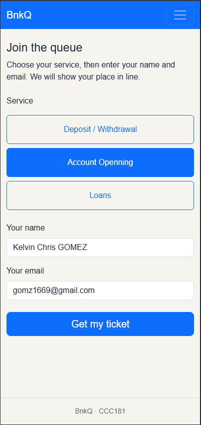
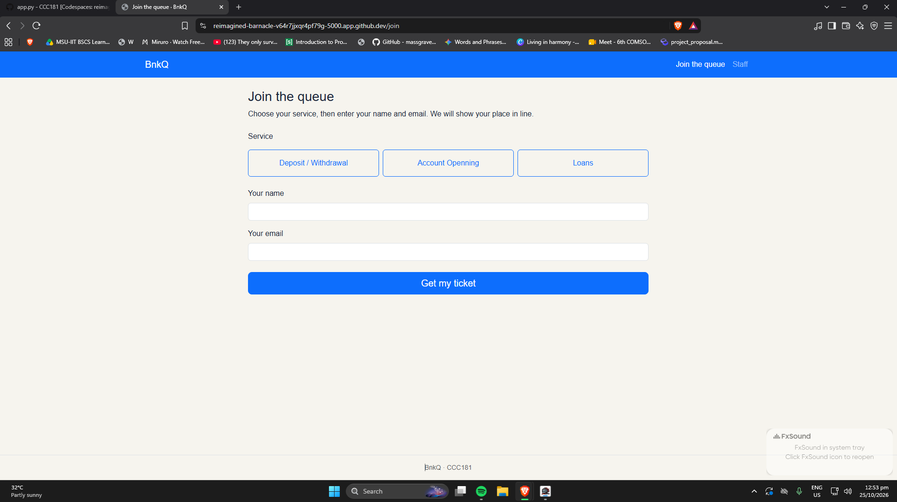
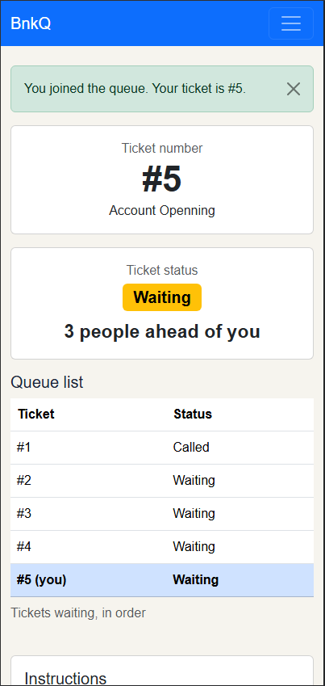
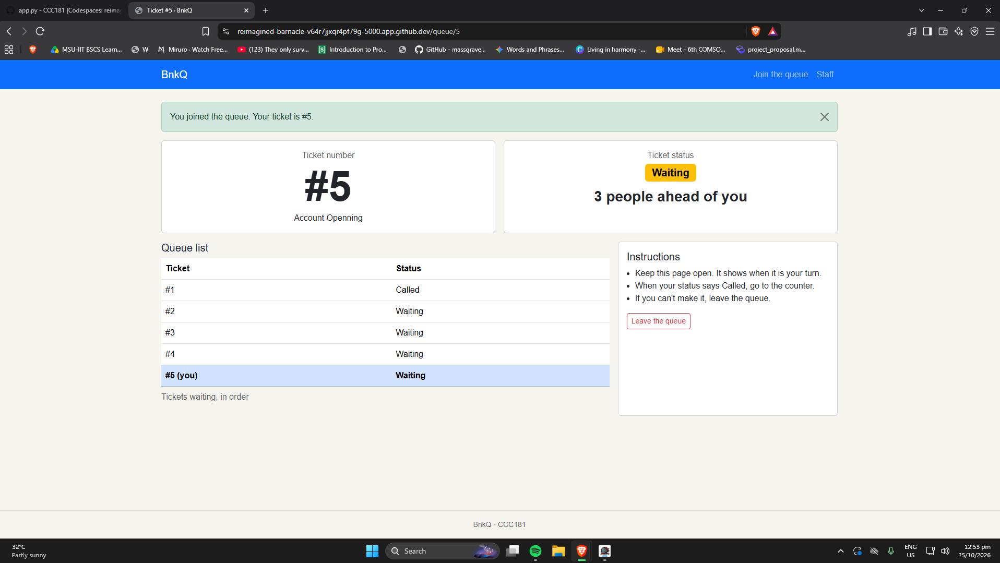
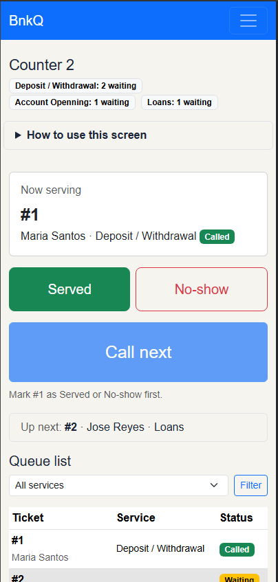
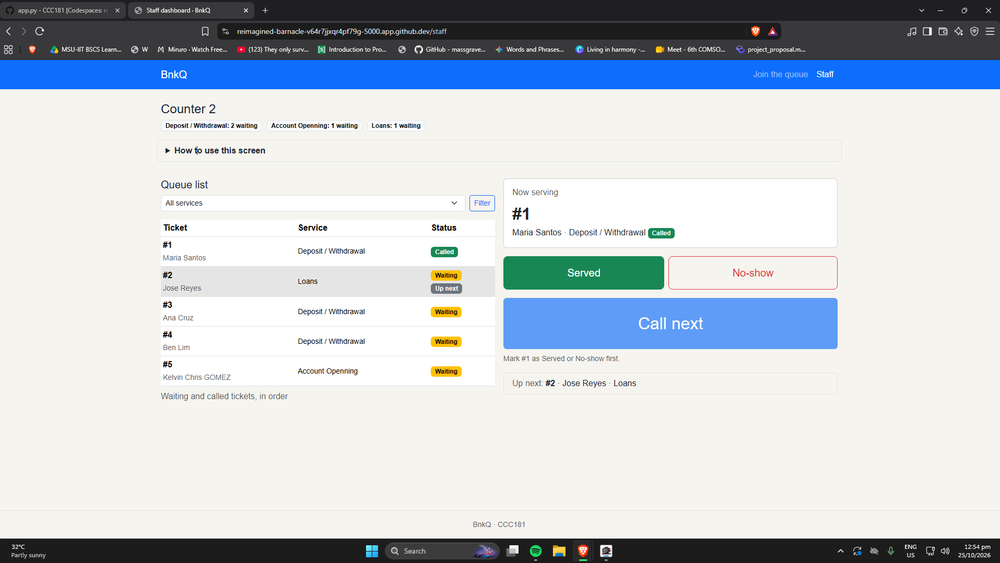
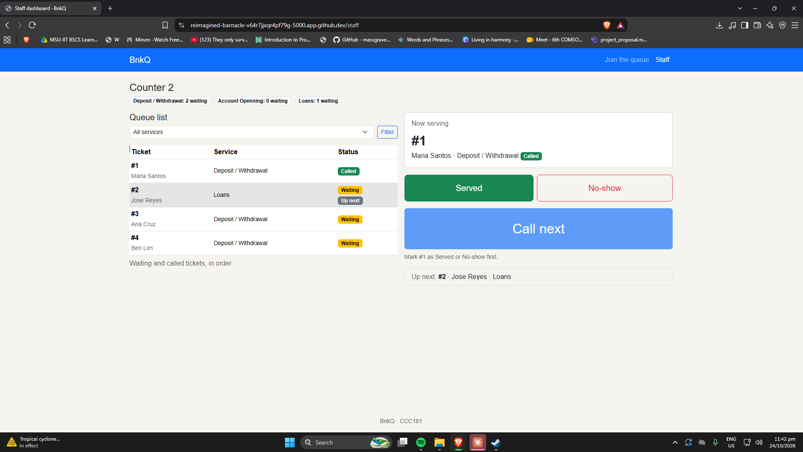
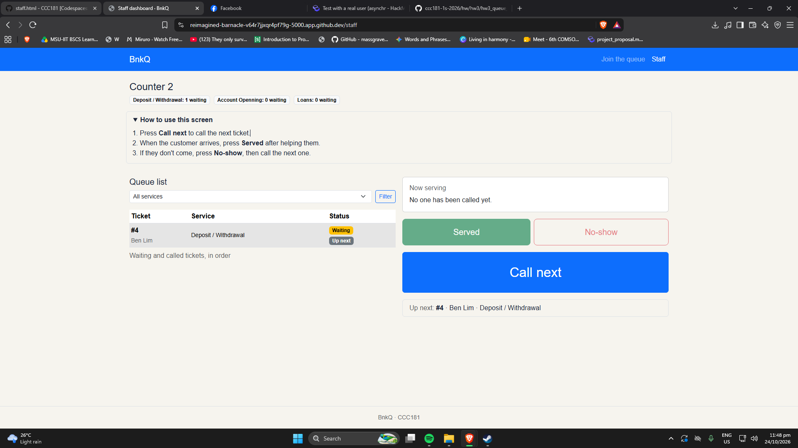

# BankQ: Week 3 Report

## Title details
- **App:** BnkQ
- **Setting:** Bank branch queue
- **Name:** Kelvin Chris S. Gomez
- **Student ID:** 2024-0878
- **Section:** CS3A
- **Date:** 24 October 2026
- **Pull request:** [link to your pull request]

## Personas
Full details: [personas.md](personas.md)

**Jill Royce, the waiting person**
> "Two hours just to open an account. I could have finished my whole day's work."

Top tasks: join the queue by choosing a service (FR-01), check my position and people ahead (FR-02), get alerted when I'm near the front (FR-03).

**Isabella Roberts, the bank teller**
> "I call a number and half the time nobody comes, and the whole line just sits there waiting on me."

Top tasks: see the waiting tickets in order (FR-04), call the next customer (FR-05), mark a customer as served or no-show (FR-07, FR-08).

## Screens
Jill uses Join on her phone to choose a service and get a ticket (FR-01).

The same Join screen on a laptop (FR-01).

Jill checks her ticket number, status, position and alert here (FR-02, FR-03).

The same My place screen on a laptop, with the queue list and instructions side by side (FR-02, FR-03).

Isabella's dashboard on a phone, with Now serving and Call next first (FR-04, FR-05, FR-07, FR-08).

Isabella's main screen on a laptop at Counter 2, with the queue on the left and the actions on the right (FR-04, FR-05, FR-07, FR-08).

## Design decisions
1. **Ticket number and position are the largest things on My place.** Jill checks her phone between tasks (her persona and rule 1), so the number and "N people ahead of you" are readable in a glance, with the status written as a word.
2. **Call next is the biggest button, and Served and No-show are the same size next to Now serving.** Isabella has only a few seconds between customers (her rules 1 and 3), so the most frequent action is the easiest to hit, and No-show is beside the ticket she just called.
3. **The alert is a banner and the queue list stays visible.** My self-review found that a pop-up covered the ticket number at the moment it mattered most, so the alert now sits above the list and nothing is hidden. The list shows only ticket numbers, never other people's names.

## Self-review
Full review: [feedback.md](feedback.md)
- **Join:** the buttons were all labelled placeholders, so I wrote real service names and added name and email fields.
- **My place:** the number and status were small and the pop-up hid them, so I made them larger and turned the pop-up into a banner.
- **Staff dashboard:** one cycle of work was split across three screens, so I merged it into one, renamed "Show" to "Served", and made Served and No-show the same size.

## Accessibility
Full notes: [accessibility.md](accessibility.md)

| Screen | Lighthouse score |
|---|---|
| Join | 97 |
| My place | 98 |
| Staff | 98 |

Most important issue fixed: none.

## Usability test
Full notes: [usability-test.md](usability-test.md)
- **Task 1 (join):** finished, with ease and in a short time.
- **Task 2 (number and position):** finished. The tester said the answer was "already on the screen".
- **Task 3 (staff: call next, mark served):** finished. The tester hesitated when watching the staff-dashboard but quickly worked it out.
- **Rules:** Jill's rules 1 and 2 held up. Rule 3 is untested because I didn't try it on mobile data. All of Isabella's rules held up.

**Improvement:** [Added a "How to use this screen" box / a "Next:" line to the staff dashboard, because the tester hesitated on Task 3.]

| Before | After |
|---|---|
|  |  |

## Reflection
- **Hardest this week:** The hardest task I have tackled this week is making the staff.html from scratch since there is no staff.html yet. Making it look like my wireframe is a challenging task. Making the wireframe also did give me a hard time but because I didn't really read the question as I did 12 total frames, instead of only 6 frames.
- **What changes in Week 4:** tickets currently live in a Python list, so they reset every time the server restarts. With a database, I will store tickets and their status in a table, calculate "people ahead" with a query instead of looping over a list, and add a counter to each ticket so the staff dashboard can show each counter's own queue.
