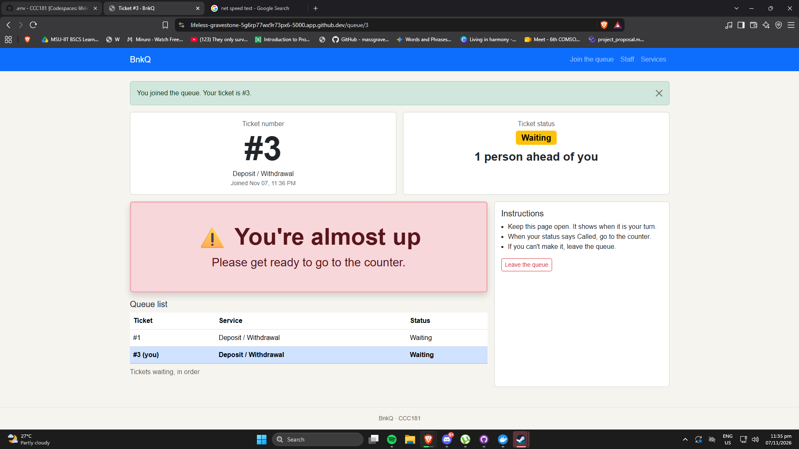
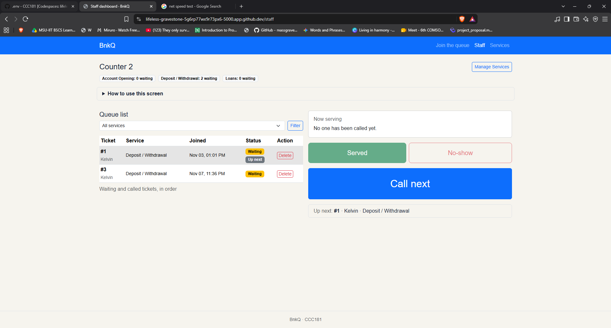
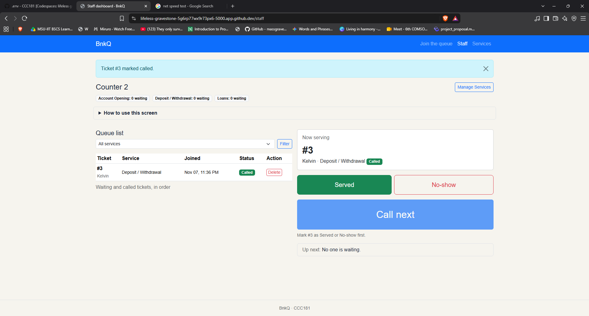
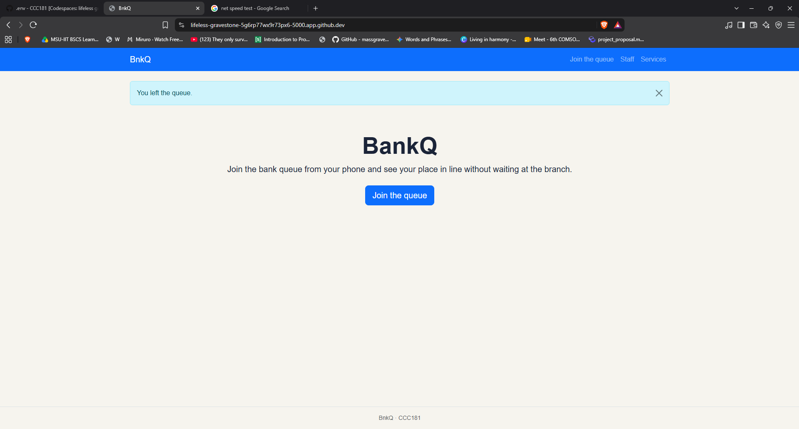
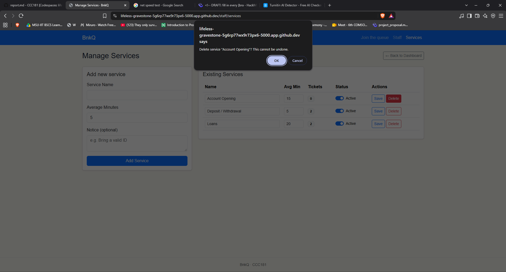
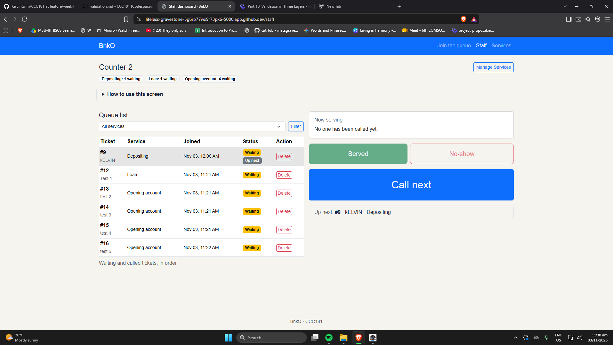
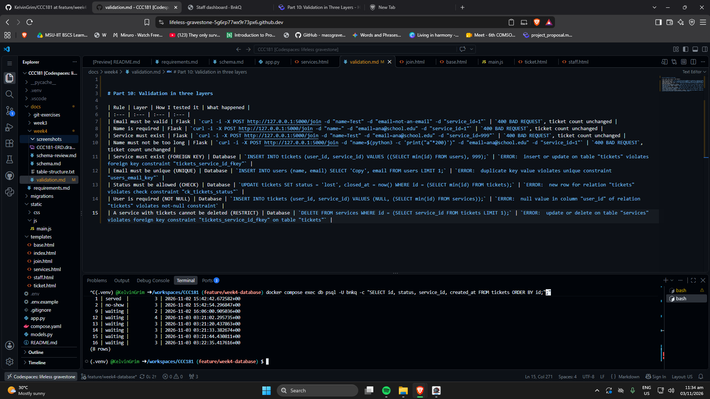
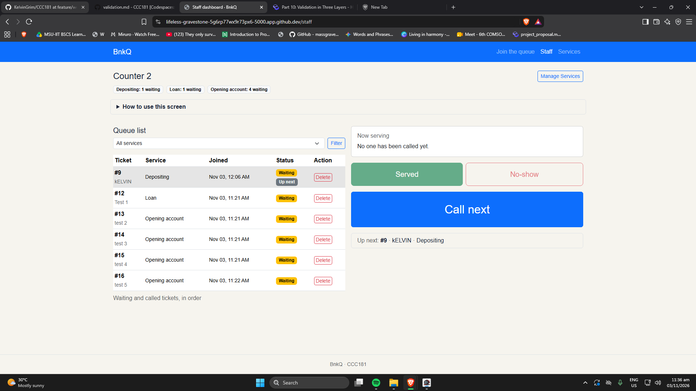
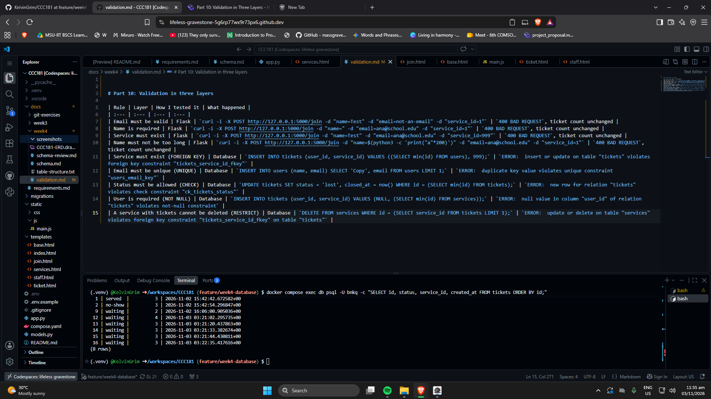

# BnkQ: Week 4 Report

## Title details

- **App:** BnkQ
- **Setting:** Bank branch queue, weekday afternoons
- **Name:** Kelvin Chris S. Gomez
- **Student ID:** 2024-0878
- **Section:** CS2A
- **Date:** November,7,2026
- **Pull request:** [Pull request link](https://github.com/KelvinGrim/CCC181/pull/9)
- **Database:** PostgreSQL 17 in Docker Compose

## Requirements

I wrote 18 functional and 7 non-functional requirements. The MVP is [list the IDs from requirements.md].

I showed the list to a bank customer who said "Kapoy jod ug hulat sa banko, dugay kaayo ko matawag samot kung daghan tao. Dili ko makabantay nga hapit na diay akong number dayon.". Because of that I Added FR-13.

Full list: [requirements.md](../requirements.md)

## ERD


- One user has many tickets. Each ticket belongs to exactly one user.
- One service has many tickets. Each ticket is for exactly one service.

The foreign key is always on the "many" side, which is `tickets`. Full design: [schema.md](schema.md)

## Schema

```text
                                    Table "public.users"
 Column |          Type          | Collation | Nullable |              Default              
--------+------------------------+-----------+----------+-----------------------------------
 id     | integer                |           | not null | nextval('users_id_seq'::regclass)
 name   | character varying(100) |           | not null | 
 email  | character varying(120) |           | not null | 
 role   | character varying(10)  |           | not null | 'customer'::character varying
Indexes:
    "users_pkey" PRIMARY KEY, btree (id)
    "users_email_key" UNIQUE CONSTRAINT, btree (email)
Check constraints:
    "ck_users_email" CHECK (email::text ~~ '%%_@_%%'::text)
    "ck_users_role" CHECK (role::text = ANY (ARRAY['customer'::character varying, 'staff'::character varying]::text[]))
Referenced by:
    TABLE "tickets" CONSTRAINT "tickets_user_id_fkey" FOREIGN KEY (user_id) REFERENCES users(id) ON DELETE RESTRICT
```

```text
                                      Table "public.services"
   Column    |         Type          | Collation | Nullable |               Default                
-------------+-----------------------+-----------+----------+--------------------------------------
 id          | integer               |           | not null | nextval('services_id_seq'::regclass)
 name        | character varying(60) |           | not null | 
 is_active   | boolean               |           | not null | true
 avg_minutes | integer               |           | not null | 5
 notice      | text                  |           |          | 
Indexes:
    "services_pkey" PRIMARY KEY, btree (id)
    "services_name_key" UNIQUE CONSTRAINT, btree (name)
Check constraints:
    "ck_services_avg_minutes" CHECK (avg_minutes > 0)
Referenced by:
    TABLE "tickets" CONSTRAINT "tickets_service_id_fkey" FOREIGN KEY (service_id) REFERENCES services(id) ON DELETE RESTRICT

```

```text
                                       Table "public.tickets"
   Column    |           Type           | Collation | Nullable |               Default               
-------------+--------------------------+-----------+----------+-------------------------------------
 id          | integer                  |           | not null | nextval('tickets_id_seq'::regclass)
 user_id     | integer                  |           | not null | 
 service_id  | integer                  |           | not null | 
 status      | character varying(20)    |           | not null | 'waiting'::character varying
 is_priority | boolean                  |           | not null | false
 created_at  | timestamp with time zone |           | not null | now()
 called_at   | timestamp with time zone |           |          | 
 closed_at   | timestamp with time zone |           |          | 
Indexes:
    "tickets_pkey" PRIMARY KEY, btree (id)
Check constraints:
    "ck_tickets_called_at" CHECK (called_at IS NULL OR called_at >= created_at)
    "ck_tickets_closed_at" CHECK (closed_at IS NULL OR closed_at >= created_at)
    "ck_tickets_closed_matches_status" CHECK ((status::text = ANY (ARRAY['waiting'::character varying, 'called'::character varying]::text[])) = (closed_at IS NULL))
    "ck_tickets_status" CHECK (status::text = ANY (ARRAY['waiting'::character varying, 'called'::character varying, 'served'::character varying, 'no-show'::character varying, 'left'::character varying]::text[]))
Foreign-key constraints:
    "tickets_service_id_fkey" FOREIGN KEY (service_id) REFERENCES services(id) ON DELETE RESTRICT
    "tickets_user_id_fkey" FOREIGN KEY (user_id) REFERENCES users(id) ON DELETE RESTRICT
```

## Design decisions

1. **Position in line is computed, not stored.** Jill needs to see how many people are ahead of her (FR-02). A stored position would have to be rewritten for many rows every time someone joins or leaves, so I store `created_at` and count the waiting tickets that joined earlier.
2. **Leaving the queue changes the status to `left` and keeps the row.** Isabella's reports need to know how many people left before being served (FR-07), and a deleted row would lose that. A hard delete exists only for mistaken tickets.
3. **`is_priority` is on `tickets`, not `users`.** Whether someone uses the priority lane (FR-08) can change from one visit to the next, so it is a fact about the visit, not about the person.


## Self-review

Full review: [schema-review.md](schema-review.md)

- **Unused column and a missing requirement:** `avg_minutes` was not needed by any requirement, and Jill's need to know how long she will wait was missing. I [added a requirement / kept the column].
- **Double tap:** nothing stopped one person from holding two active tickets for the same service. I [what you did].
- **Status and `closed_at` could disagree:** I added a CHECK so `closed_at` is empty exactly when the status is `waiting` or `called`.
- **Email as identity:** the database accepted any text as an email, so I added `CHECK (email LIKE '%_@_%')`.

## Migrations

- `2d12844c2820_initial_tables.py`: creates the `users`, `services` and `tickets` tables with their keys and constraints.
- `[second migration file]`: [one sentence on what it does].

## CRUD

| Operation | Route | Requirement | Screenshot |
| :--- | :--- | :--- | :--- |
| Create | `POST /join` | FR-01 |  |
| Read | `GET /queue/<id>` and `GET /staff` | FR-02, FR-12 |  |
| Update | `POST /staff/tickets/<id>/<action>` | FR-03, FR-04 |  |
| Soft delete | `POST /queue/<id>/leave` | FR-05 |  |
| Hard delete | `POST /staff/tickets/<id>/delete` | [requirement ID] |  |

## Validation

Full results: [validation.md](validation.md)

I tested the rules in two layers. With `curl` I skipped the form and Flask returned `400` and saved nothing. With `psql` I skipped Flask and PostgreSQL refused each bad row, with one test for each constraint type: foreign key, unique, check, not null and restrict.

The most useful error was [the error you found most useful, and why].

## Persistence
**Before**



**After**



After `docker compose down` and `docker compose up -d`, every ticket, status and time was identical. I then ran `docker compose down -v`, `docker compose up -d`, `flask --app app db upgrade` and `flask --app app seed`. [The app opened, my services showed on the join form, and I could join.]

NFR-01 (no ticket is lost when the server or the database restarts): [passed].

Full notes: [persistence.md](persistence.md)

## Reflection

- **Hardest this week:** The hardest I did this week is making the data base, using docker for the first time. I have a hard time making it and how the docker commands, I have to search what the commands really do. Running the database migrations was also challenging, as I had to update other parts of the application code to make sure everything was compatible before it could be migrated successfully
- **Hardest requirement to write in a testable way:** The priority lane requirement (FR-08). It is easy to say "priority customers get served faster," but that isn't testable. I had to specifically define the queue logic: when the staff clicks 'Next', the system must return the oldest ticket where is_priority is true, and only if there are no priority tickets should it return the oldest regular ticket..
- **A report Isabella would want from this data:** A report Isabella would want from this data: the number of "no-show" tickets compared to "served" tickets per hour. Since she hates it when called customers don't come to the counter, this report would show her exactly what time of day people are most likely to wander off. I will write that query in Week 5.

## Declaration

I used **Claude** to help draft the initial requirements, schema, ERD, and code. I used **Gemini** to help troubleshoot Docker and PostgreSQL connection errors, and explain design decisions. I used **Grammarly** to check my spelling and grammar. I reviewed, tested, and executed all the code and database commands myself, and adjusted the final text to reflect my actual design choices.