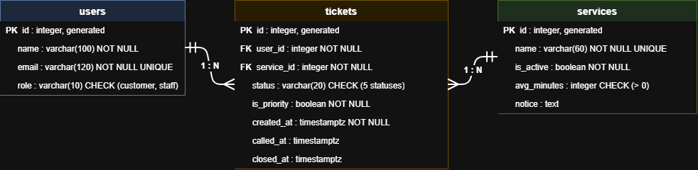

# BankQ schema

## 2a. Nouns in the requirements

| Req ID | Requirement | Nouns | Table or column? |
| --- | --- | --- | --- |
| FR-01 | A customer can join the queue by choosing a service and entering their name and email. | **customer**, **queue**, **service**, **name**, **email** | users, (not a table), services, users.name, users.email |
| FR-02 | A customer can see their ticket number, status and how many people are ahead of them. | **ticket number**, **status**, **people ahead** | tickets.id, tickets.status, (computed) |
| FR-03 | A staff member can call the next waiting ticket, once the current one is finished. | **staff member**, **ticket**, **status** | users (role = staff), tickets, tickets.status, tickets.called_at |
| FR-04 | A staff member can mark a called ticket as served or no-show. | **ticket**, **served**, **no-show** | tickets.status, tickets.closed_at |
| FR-05 | A customer can leave the queue before being called. | **customer**, **queue** | tickets.status = left, tickets.closed_at |
| FR-06 | A staff member can add, rename and switch off a service. | **service** | services.name, services.is_active |
| FR-07 | A staff member can see how many people left before being served, per service, per day. | **people**, **service**, **day** | (computed from tickets.status, service_id, created_at) |
| FR-08 ★ | A senior citizen or person with a disability can join a priority lane that is served first. | **senior citizen**, **priority lane** | tickets.is_priority |
| FR-15 ★ | A customer is told which documents to bring before they join. | **documents** | services.notice |
| FR-16 | Tickets and their status are kept when the server restarts. | **tickets** | all tables |
| FR-17 | A staff member can undo a ticket marked no-show by mistake. | **ticket** | tickets.status, tickets.closed_at |

FR-13 and FR-14 (which counter to go to, and a counter seeing only its own services) also store data, but they are marked Later. They are covered under "Later extension" at the end of this file.

**Two rules I followed:**
- The queue is not a table. It is all tickets with status `waiting` for one service, ordered by priority and then `created_at`.
- Store facts, not results. The app stores when a ticket was created (`created_at`). "People ahead" and a ticket's position are computed when needed, so nothing has to be rewritten when someone joins or leaves.

## 2b. Tables and columns

| Table | Columns |
| --- | --- |
| users | id, name, email, role |
| services | id, name, is_active, avg_minutes, notice |
| tickets | id, user_id, service_id, status, is_priority, created_at, called_at, closed_at |

Where each fact lives:
- A fact about the **person** (name, email, role): `users`.
- A fact about the **service** (name, whether it is open, average minutes, a short notice): `services`.
- A fact about **this one visit** (status, priority, when it was created, called and closed): `tickets`.

A returning customer keeps one `users` row, because `email` is unique. When someone joins, the app looks up their email and reuses that row, and only creates a new row for a new email.

## 2c. Types and constraints

| Table | Column | PostgreSQL type | Constraint | Why |
| --- | --- | --- | --- | --- |
| users | id | integer, generated | PRIMARY KEY | Generated by the database, never reused |
| users | name | varchar(100) | NOT NULL | Staff need a name to call out |
| users | email | varchar(120) | NOT NULL UNIQUE | One account per email |
| users | role | varchar(10) | NOT NULL DEFAULT 'customer', CHECK (role IN ('customer','staff')) | Only two kinds of user |
| services | id | integer, generated | PRIMARY KEY | Generated by the database, never reused |
| services | name | varchar(60) | NOT NULL UNIQUE | No two services with the same name |
| services | is_active | boolean | NOT NULL DEFAULT true | Switching a service off keeps its old tickets |
| services | avg_minutes | integer | NOT NULL DEFAULT 5, CHECK (avg_minutes > 0) | Rejects impossible values |
| services | notice | text | none (optional, can be empty) | One short note, such as "Bring a valid ID" |
| tickets | id | integer, generated | PRIMARY KEY | The ticket number. Generated by the database, so two people can never get the same one |
| tickets | user_id | integer | NOT NULL REFERENCES users(id) | No ticket without a person |
| tickets | service_id | integer | NOT NULL REFERENCES services(id) | No ticket for a missing service |
| tickets | status | varchar(20) | NOT NULL DEFAULT 'waiting', CHECK (status IN ('waiting','called','served','no-show','left')) | Only the five statuses the app uses |
| tickets | is_priority | boolean | NOT NULL DEFAULT false | Can change with each visit |
| tickets | created_at | timestamptz | NOT NULL DEFAULT now() | Time zone safe, set by the database |
| tickets | called_at | timestamptz | CHECK (called_at IS NULL OR called_at >= created_at) | Empty until called, and never before the ticket exists |
| tickets | closed_at | timestamptz | CHECK (closed_at IS NULL OR closed_at >= created_at) | Set when served, no-show or left. Never before the ticket exists |

Every required kind of constraint is used: PRIMARY KEY, FOREIGN KEY (`REFERENCES`), NOT NULL, UNIQUE, CHECK and `timestamptz`.

- The first index keeps My place and the staff dashboard fast as old tickets pile up.
- The second makes the database refuse a second called ticket, so the rule "finish the current customer first" also holds when two staff requests arrive at once.

## 2d. ERD

**Relationships, read aloud:**
- One user has many tickets (1 : N). Each ticket belongs to exactly one user.
- One service has many tickets (1 : N). Each ticket is for exactly one service.

The foreign key always sits on the "many" side, which is `tickets`.

**What happens when a parent row is deleted:**

| Foreign key | On delete | Reason |
| --- | --- | --- |
| tickets.user_id → users | RESTRICT | Old tickets are needed for reports, so a user who has tickets cannot be deleted |
| tickets.service_id → services | RESTRICT | The bank keeps old tickets. A service is switched off with `is_active`, not deleted |

## 2e. Normalization

1. **One value per cell (1NF):** yes, every column holds a single value. `services.notice` is one short note, not a list of documents. If the bank wanted a list per service, it would need its own table.
2. **Depends on the whole key (2NF):** there are no join tables, and every other table has a single-column key, so nothing can depend on only part of a key.
3. **No hidden copies (3NF):** a person's email lives only in `users`, and a service's name only in `services`. Tickets point to them by id, so renaming a service or changing an email is one update.
